<!-- The card below is rebuilt daily by .github/workflows/stats.yml from GitHub's contribution calendar. Edit the whoami lines in profile.config.json. -->

  

## Selected work

Most of what I build lives in private repos, because it's built around real workflows and personal context. These case studies show what each system does, how it's built and where it stands.

| Project | What it is | Stage |
|---|---|---|
| **[SOLUTION-OS](https://github.com/ChadisBrad/solution-os-case-study)** | A chief-of-staff agent built on Claude Code: a fail-closed guard hook, a hidden-payload scanner, scheduled cloud routines and a phone relay. 167 tests. | Internal tool, live for one user |

## How I build now

These are the rules my current work runs on. Older prototypes are being brought up to them.

- **Deterministic first.** Parsing, dates, maths and rules live in code. Models handle only what code can't.
- **Unknown beats invented.** When a value isn't there, the output says so and why, rather than guessing.
- **Fail closed.** A guard that can't decide blocks. Anything irreversible waits for a human.
- **Untrusted text is data.** Emails, web pages and documents are never treated as instructions.
- **Prove, don't claim.** Tests, run logs and plain status labels, not demos.

## Toolbox

Python · JavaScript (Node) · Claude Code (hooks, skills, subagents, plugins, routines) · OpenAI API · PySide6 · Tesseract OCR · pandas · pytest · PyInstaller · Cloudflare Workers · Luau (Roblox)
