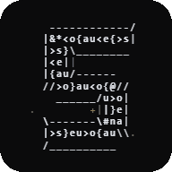

### Sol Soleiman

Insurance broker building the systems broking never had.

I turn the work brokers still do by hand into software: the data underneath, the tools on top, and agents that work across both.

- **Data layer** · one place to review how every tool uses broker data and stay compliant. It pulls clients, policies and premiums out of legacy broking systems, fixes the duplicates and gaps, and serves one source of truth through an API.
- **CRM** · built around renewals and policies and kept in sync with the data layer. An MCP connector lets AI agents read and update it, with permissions on every action.
- **SOLUTION-OS** · an agent system that plans, researches and reviews its own work, and only interrupts me when a decision is mine.
- **Broker Tools** · a PDS library, a template library, policy comparisons and schedule reformatting. Seconds instead of hours.
- **Local-first security** · client documents are read on your own device and never uploaded. The tools are AES-256 encrypted, unlock in your browser, and sit behind Cloudflare Zero Trust sign-in.

Most of it runs on real broker data, so the code is private. Ask and I'll walk you through it.

[LinkedIn](https://www.linkedin.com/in/sol-soleiman-aba743337/) · [SOLUTION-OS case study](https://github.com/ChadisBrad/solution-os-case-study)
