<!-- The card is assets/card.svg, built by scripts/gen-card.mjs from profile.config.json. It holds no live data, so it never goes stale. Edit the config, run `node scripts/gen-card.mjs`, commit. The <picture> wrapper stops GitHub turning the card into a link to the raw SVG. -->

  <picture></picture>

  <a href="https://www.linkedin.com/in/sol-soleiman-aba743337/">LinkedIn</a>
  &nbsp;·&nbsp;
  <a href="https://github.com/ChadisBrad/solution-os-case-study">SOLUTION-OS case study</a>

Most of my work lives in private repos. Ask and I'll walk you through it.

